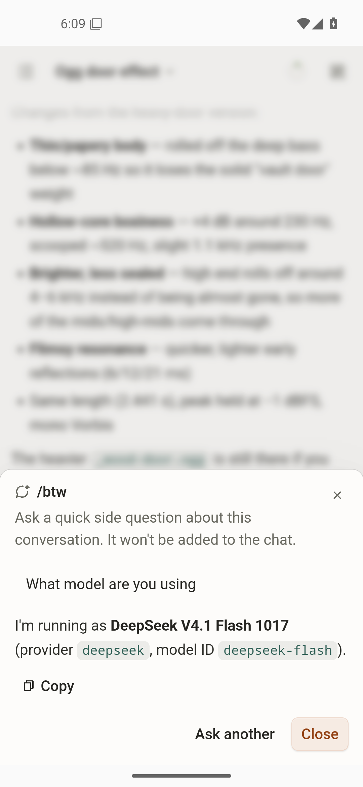

# openchamber-btw

A stateless `/btw` for [OpenChamber](https://github.com/openchamber/openchamber): ask a quick side question without creating a session, forking the chat, or touching the main transcript.

<p align="center">
  
</p>

OpenChamber's stock `/btw` creates a hidden fork session. That is durable, has to wait for the main turn, and leaves another session behind. This project replaces it with one call to OpenCode's `session.generate`, shown in a small transient dialog.

> This is an unofficial community patch. OpenChamber is maintained by its own contributors.

## What it does

- `/btw <question>` answers from the current conversation's settled context.
- No session is created, forked, renamed, or written to. The answer stays out of the chat history.
- Works while the main agent is generating or running tools. The request has its own `AbortController`.
- The answer appears in a closeable dialog with copy, retry, and "ask another".
- Dismissing the dialog aborts only the side question, never the main turn.
- A five-minute timeout turns a stuck request into a retryable error.
- Legacy `/btw` fork sessions stay hidden. If one is promoted to a normal session, it keeps the notice that lifts the old side-chat constraints.
- In a brand-new chat draft there is no parent session, so `/btw` says "Open a session first" and leaves the text alone. It does not create the session it is supposed to avoid.

The same shared UI is used by the desktop app, browser, VS Code extension, and the Capacitor mobile app.

## Install a prebuilt build

See [Releases](https://github.com/opigod/openchamber-btw/releases/latest) for:

- `openchamber-btw-<version>-1-x86_64.pkg.tar.zst` — Arch Linux package
- `OpenChamber-btw-<version>-android-debug.apk` — Android debug APK

### Arch Linux

```bash
sudo pacman -U openchamber-btw-<version>-1-x86_64.pkg.tar.zst
```

The package installs to `/opt/openchamber`, adds `openchamber` to `PATH`, and creates a desktop entry. It conflicts with and replaces `openchamber-custom`.

### Android

```bash
adb install -r OpenChamber-btw-<version>-android-debug.apk
```

The Android app is a Capacitor shell. It connects to an existing OpenChamber server; it does not embed the server or OpenCode.

## Build from source

The builder downloads the supported OpenChamber release (`v2.7.2`), applies `btw-stateless.patch`, and builds the requested target. Use `--ref` to build another tag or branch.

```bash
git clone https://github.com/opigod/openchamber-btw.git
cd openchamber-btw

# Linux package, then install it through pkexec/pacman
./build-openchamber.sh --target linux --install

# Android debug APK, installed over adb when a device is connected
./build-openchamber.sh --target android --install

# Both
./build-openchamber.sh --target all
```

Outputs go to `~/.cache/openchamber-btw-builder/out/` unless `--workdir` is set.

### What the script provisions

If a tool is missing, the builder installs it into its cache:

- Bun
- Temurin JDK 21 for the Android build
- Android command-line tools, platform-tools, and the platform/build-tools that match `packages/mobile/android/variables.gradle`

The Android SDK package naming changed with newer API levels. The script asks `sdkmanager` what exists, so it handles both `platforms;android-35` and `platforms;android-37.0`.

On Arch, the install step removes an existing `openchamber-btw` or `openchamber-custom` first. pacman refuses to replace a conflicting package under `--noconfirm`, so doing it in a separate transaction is intentional.

### Requirements

Linux builds use `makepkg`, `pacman`, and `pkexec`, so they target Arch-based systems. On another distribution, use the `linux-unpacked` directory the build leaves in the source tree.

The Android build uses the project's Gradle wrapper. A physical device or emulator needs to be visible to `adb` for `--install`.

## Usage

Open an existing chat, then type:

```text
/btw why did step 2 fail?
```

Press Enter or the send button. The dialog opens immediately, then shows the answer when `session.generate` returns.

From an empty new-chat screen, `/btw` shows **Open a session first**. Open or create a normal chat first if you want a side question.

## How it works

The patch is deliberately small at the edges:

| Piece | Role |
| --- | --- |
| `packages/ui/src/lib/btw.ts` | Builds the prompt, calls `opencodeClient.generateSessionText`, owns the request's `AbortController`, timeout, and retry state. |
| `packages/ui/src/stores/useBtwStore.ts` | Per-parent-session request state, keyed to the composer that opened it so two panels do not stack dialogs. |
| `packages/ui/src/components/chat/btw/BtwDialog.tsx` | The transient compose / running / answered / failed dialog. |
| `packages/ui/src/components/chat/ChatInput.tsx` | Recognizes `/btw` before the normal send gates and mounts the dialog. |
| `packages/ui/src/components/chat/composer/submit/slashCommands.ts` | Plans `/btw` as a local action even without a session, so it is never sent as a prompt. |
| `packages/ui/src/lib/opencode/client.ts` | Adds abort-signal support to `generateSessionText`. |

`session.generate` is a one-shot endpoint: it exposes the session's tools but does not run a tool loop. The dialog's prompt therefore says to answer from what the model already knows and not to call tools.

More detail: [docs/HOW-IT-WORKS.md](docs/HOW-IT-WORKS.md). Maintainers and agents should start with [AGENTS.md](AGENTS.md).

## Compatibility and updating the patch

The patch was generated against OpenChamber `v2.7.2` (`1a15151`). The builder applies it with `git apply --3way` and fetches that base commit when a shallow clone does not have it.

If upstream changes one of the touched files, the patch can conflict. The script stops and leaves the checkout in place. Regenerate the patch from the fork:

```bash
git clone https://github.com/opigod/openchamber.git
cd openchamber
git fetch origin --tags
git switch feat/stateless-btw-latest
git rebase v2.7.2
git diff v2.7.2..HEAD > /path/to/openchamber-btw/btw-stateless.patch
```

Then update `PATCH_BASE` in `build-openchamber.sh` to the new upstream base and rebuild.

The fork branch is <https://github.com/opigod/openchamber/tree/feat/stateless-btw-latest>.

## Upstream status

Submitted to OpenChamber:

- PR: <https://github.com/openchamber/openchamber/pull/6547>
- Feature request: <https://github.com/openchamber/openchamber/issues/6548>

The PR is waiting for the linked feature request to be marked `accepted`. The bot reopens the PR automatically once that happens. Until then, this repository is the standalone build and distribution point.

## Notes

- The Android APK is a debug build, not a Play Store release.
- The Linux package is built by `makepkg`; the desktop app's built-in updater only recognizes AppImage, deb, and rpm, so rebuild or reinstall this package to update.
- The answer is non-streaming because `session.generate` is a one-shot endpoint.
- Attachments stay in the composer. `session.generate` accepts a prompt only.

## Repository layout

```text
.
├── AGENTS.md                 # maintainer/agent operating manual
├── build-openchamber.sh      # Linux and Android builder
├── btw-stateless.patch       # the /btw change, applied to upstream
├── assets/                   # screenshots used here
├── docs/HOW-IT-WORKS.md      # request flow and design notes
└── README.md
```

## License

The builder and patch are MIT licensed. OpenChamber itself is MIT licensed and remains the work of its contributors.
